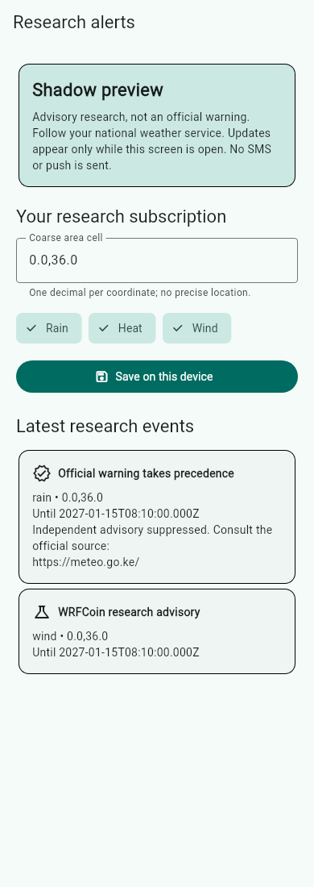
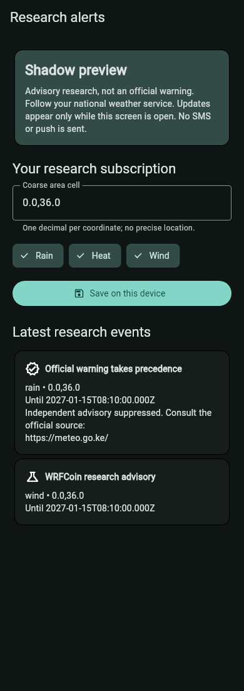

# Foreground-only research alerts (transport P)

Refs wrfcoin/mobile-archive#436 and wrfcoin/core4-archive#3573.

Default off. Build with `--dart-define=WRFCOIN_SHADOW_ALERTS=on` to show the research
button on Weather Alerts. The feature lazily constructs its controller only when
opened. It uses the existing authenticated API client and backend GET
`/api/weather/alerts/shadow`. The backend must separately enable its shadow flag
and apply its reviewed manual migration. No runtime/deployment acceptance is claimed.

Subscriptions are device-local: coarse area and selected rain/heat/wind hazards.
There is no phone number, token registration or server subscription sync. Polling
is limited to this screen while the app is resumed. Pause/inactive/hidden/detached
cancel the request and timer; disposal also cancels both. Late responses are ignored,
stale events filtered and no overlapping polls allowed. Empty or failed responses
never say all-clear. Suppressed advisories show the official-source pointer.

No push/FCM, SMS, local notification or background worker is created. Quiet-hours
and server sync from the older archive issue are deferred under the transport-P
foreground-only contract. No live verified-readback producer is available yet;
backend records are populated by trusted research evaluation only.

Screenshots are actual Flutter widget renders with explicitly synthetic populated
fixtures, not a device run or live data. Generate with:

```
ALERT_SCREENSHOT_FONT=<flutter-sdk>/bin/cache/artifacts/material_fonts/Roboto-Regular.ttf \
  flutter test --update-goldens test/features/weather/alerts/shadow_alerts_screenshots_test.dart
```



