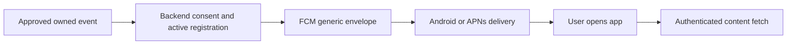

# Remote push notifications: proposed FCM design

Refs #36 and #271; readiness-v21 input 47. SOL-K, Round 7, 2026-10-02.
**Design only. No implementation, provisioning or release enablement authorized.**

## Decision and verified starting point

The owner's recorded local-alerts decision
on 2026-09-21 chose local alerts for testnet and excluded server-initiated push.
Round 7 requests this design, without overturning that delivery decision.
Remote push stays disabled for r19 unless the owner separately changes scope.
This document proposes FCM for a later opt-in delivery; it does not claim an
operational service or that background alerts are guaranteed.

Preflight snapshot 2026-10-02T19:52:44Z: inspected main heads are mobile
`2184cf311533e9945688fdcfa3e05d67045362de`;
backend `c5cb1088cd5d019d6ac568886e3c7058e337ca81`. Source inspection only.

| Surface | Verified state and gap |
| --- | --- |
| `lib/services/notifications/fcm_token_service.dart:27` | `FcmPlatform` is abstract; the provider supplies no platform. `initialize()` returns at line 71 when it is null. Token storage/rotation/retry tests exercise injected platforms, not Firebase delivery. |
| `lib/main.dart:34` | Startup still constructs a standalone `FcmTokenService(ApiClient())` before the app container. The #271 cleanup/disclosure is not demonstrated on this head. No startup behavior changes in this design PR. |
| `pubspec.yaml`, Android Gradle/manifest, iOS Runner | No Firebase dependency or tracked Firebase configuration/FCM entitlement wiring was found. Firebase configuration filenames were inventoried; no credential or Firebase configuration values were inspected. |
| `fcm_token_service.dart:123` | Candidate POST path `/notifications/push-token`, platform `unknown`; no explicit wallet gate, owner-scoped registration timestamp, subscription disposal, remote revocation or generation protection. These are implementation prerequisites. |
| `notification_payload_router.dart`, `push_service.dart` | Local-notification API and routing seam exist. The local plugin initialization has no tap callback; router tests call the seam through a spy navigator. No remote on-message/open/initial-message wiring is demonstrated. Numeric `type`/`proposalId` casts can throw; unknown raw types enter fallback log fields. Harden before accepting remote input. |
| Backend `server/routes/capabilities-routes.ts:198` | Notifications capability remains unavailable. Tracked server/source/package searches found no push-token route, Firebase sender or token registry. A mounted, authenticated route and migration are future work. |

The notification scaffold was recorded at historical revision
`5554a7b44c3f376554e349689545c17bc8840518`, verified ancestor of the inspected
mobile main. Its scaffold does not establish remote-delivery readiness.
At preflight mobile#386 touched notification services mechanically. It merged
as `dbc804d6c1a240d74705c2f9106a35c03a253f7d` during this design; source references
above remain pinned to the preflight snapshot. Coordinate with the service
owner before future edits. This PR adds only this note.

## Owner inputs required before implementation

No key values belong in an issue, PR, ledger, chat, log or app bundle. The owner
supplies identifiers/decisions and approved secret references through the
normal release process; this lane has not requested, read or created keys.

| Input | Required decision or artifact | Handling / responsible owner |
| --- | --- | --- |
| Scope and consent | Explicit replacement of #271's local-only choice; Android-only pilot or Android+iOS; permitted event categories, invitee consent wording and launch/release gate | Product owner; default remains off and local alerts remain described honestly |
| Firebase project | Owner-controlled project ID/number, registered app IDs, test versus production separation, authorized administrators, quota/cost limits | Owner/infra; no project creation, billing or console activity in this assignment |
| Client configuration | Owner-approved FirebaseOptions and applicable `google-services.json` / `GoogleService-Info.plist` generation/injection strategy, matched to selected app/build | Client config identifies the Firebase project; it is distinct from server signing authority. Follow release artifact policy; no values copied here |
| Android identity | Confirm current `applicationId` `com.wrfcoin.wrfcoin_mobile` and supported Google Play services devices; certificate identifiers if chosen app restrictions/attestation need them | Mobile/release owner; app-attestation policy is a separate choice |
| Apple identity and APNs | Confirm final bundle ID, Apple team ID/key ID, APNs authentication `.p8` secret reference, sandbox/production signing and push entitlement/profile | Apple/release owner uploads APNs material securely to Firebase. Profile/release currently use `WRFCOIN_IOS_BUNDLE_IDENTIFIER`; debug uses `com.wrfcoin.wrfcoinMobile`, so do not infer the shipped ID |
| Server sender identity | Dedicated FCM HTTP v1 sender principal, target project, least-privilege IAM and approved authentication method | Backend/infra; prefer an approved workload identity where supported, otherwise a protected service-account JSON file reference and rotation owner. Private keys never enter mobile config or Git |
| Registry protection | Encryption-key/secret reference, backup/access policy, deletion policy and stale-registration lifetime | Backend/infra; proposed lease is seven days, refreshed on authorized foreground use; owner must approve this policy |
| Operations and scheduling | Backend/infra owners, authenticated event source, retry/volume limits, emergency stop, SDK/cache/download approval and real-device QA access | No new packages downloaded or future delivery date promised here |

Firebase's [security checklist](https://firebase.google.com/support/guides/security-checklist)
distinguishes Firebase client API keys from sensitive service-account keys.
Client keys identify a project; restrict their APIs, and never use them as
backend authorization. APNs and server private-key material stay with their
owners; APNs inputs are needed only if iOS is selected. Web/VAPID, desktop,
location-based topics, marketing and emergency
life-safety delivery are outside the proposed first slice.

## Platform and mobile lifecycle proposal

Implement a Firebase-backed `FcmPlatform` only in a separately authorized
mobile PR, after selecting compatible `firebase_core`/`firebase_messaging`
versions and reviewing cached dependency availability. Bind it through the
real app container and configured authenticated `apiClientProvider`; do not
activate the standalone startup client. Local alerts continue independently.

The [Flutter FCM setup guide](https://firebase.google.com/docs/cloud-messaging/flutter/get-started)
requires Apple capabilities/APNs setup and a compatible Google Play services
environment for Android. Keep FCM automatic initialization disabled in native
configuration as well as the proposed default-off app gate: Android
`firebase_messaging_auto_init_enabled=false` and
`firebase_analytics_collection_enabled=false`; iOS
`FirebaseMessagingAutoInitEnabled=NO`. A prior runtime auto-init setting can
persist, so disable it again on opt-out. Do not add Analytics for this feature.
No Firebase token generation or registration before explicit consent, valid
configuration, OS permission and an authenticated current wallet.

Use one consent/permission flow for local and remote notifications; do not
prompt from background startup. Permission denial, unavailable Play services,
missing APNs token/configuration, unsupported server or expired wallet session
produces an honest unavailable/local-only state, without blocking app boot.
The [message-receiving guide](https://firebase.google.com/docs/cloud-messaging/flutter/receive-messages)
covers iOS/Android 13 permissions, cold opens and background handlers. If a
background handler is needed, use a top-level entry-point-preserved function;
no navigation, biometric prompt, wallet signing or collector upload there.
Delivery after force-stop is restricted; no guaranteed emergency-alert claim.

Retain/dispose each stream subscription; serialize token updates and make
initialization idempotent. Capture installation, wallet address, token and
generation before async work; recheck after permission/session/token/HTTP
awaits. Rotation atomically replaces the old registration. Store the token
securely and the acknowledgement against that exact installation/wallet/token
generation; the current global timestamp is insufficient. Record registration
only after a validated server receipt, never as proof of notification delivery.

Before sign-out/wallet replacement, stop streams/retries and best-effort revoke
the old registration while its session remains available. Opt-out disables
auto-init, revokes server registration and deletes the local platform token.
Dispose/wipe cancels pending requests and ignores late replies. Offline revoke
cannot recall queued OS notifications: only generic text may be displayed, and
server leases bound stale targeting. Never silently reassign an active token
to another wallet; a new owner needs successful old-owner revocation or a new
platform token. Do not reuse a Firebase Installation ID as a token implicitly.
Google's [registration-management guide](https://firebase.google.com/docs/cloud-messaging/manage-tokens)
now describes co-supported token/FID paths; verify the chosen Flutter SDK's
actual API before revising this token-based scaffold or transport contract.

## Proposed backend contract, registry and sender

These endpoints do not exist on the inspected backend; the names below are
proposals, not implemented API documentation. Backend ownership is required.

| Proposed endpoint | Contract |
| --- | --- |
| `POST /api/notifications/push-token` | Authenticated idempotent registration/rotation. Body: bounded installation ID, `kind: fcm_token`, token, `platform: android` or `ios`, and allowlisted app identity. Derive wallet owner from validated session; reject absent/`unknown` wallet, owner overrides, extra fields, arbitrary endpoints/project selection and location. Return `registered`, opaque registration ID and server lease expiry; never echo token. |
| `DELETE /api/notifications/push-token` | Authenticated idempotent revoke for an owned installation/registration. Put its opaque ID in the body, not a token in URL/query logs. A different owner cannot revoke it. |

Reuse wallet-session authentication semantics, expiry and rate limits, with
an explicit valid wallet-address guard: generic `authenticateToken` can assign
`unknown` when the claim is absent. No anonymous/API-key/admin fallback. Bound
payload size, per-owner/per-installation counts and retries; use 401/403 for
refusal, 409 for active cross-owner conflict, 422 for invalid input, 429 with a
bounded retry hint, and 503 for configured sender unavailability. Do not add a
public send endpoint or accept caller-controlled notification content/targets.

Registry proposal: encrypted token plus a keyed lookup digest, server-selected
project/app environment, installation ID, authenticated owner, consent state,
generation, creation/refresh/expiry/revocation timestamps. Unique active target
within project/environment; transactional rotation and cross-owner conflict
checks. Store no phone location or location-derived topic names. Raw tokens,
addresses, private keys and provider exception bodies are excluded from logs,
metrics and error responses. Server-selected lease expiry is authoritative.
Registration establishes wallet-scoped intent, not proof of physical device
ownership; token possession alone is insufficient for that claim. An optional
owner-approved app-attestation check supplements rather than replaces wallet
authentication and cross-owner collision refusal.

Sender consumes only approved owned events/current unrevoked registrations,
rechecks consent/lease/generation just before send, and uses an allowlisted
serializer. Use the [FCM HTTP v1 authentication model](https://firebase.google.com/docs/cloud-messaging/send/v1-api)
with short-lived OAuth credentials in a trusted server. Authenticate only to
the owner-approved Google endpoint/project; no arbitrary-host transport.
Queue/outbox idempotency, bounded backoff and volume limits are backend work.
FCM acceptance is a transport receipt, not device delivery. Expired or
`UNREGISTERED` targets are retired; treat `INVALID_ARGUMENT` as a token error
only after separately establishing a valid message payload. Credential failures
stop/retry safely without deleting all registrations. No live sender is tested
or enabled by this note.

## Payload privacy and phone flow

FCM transport encryption does not provide application-level end-to-end secrecy;
[Google documents generic wake notifications plus direct content retrieval](https://firebase.google.com/docs/cloud-messaging/encryption).
Send only a generic display envelope and a small validated routing hint. On an
explicit tap, fetch current content through existing authenticated/coarse-location
app paths; recheck the selected wallet and location permission there. No remote
payload triggers a transfer, signing prompt, reading upload or location request.

Proposed first type is only `alert`, mapped locally to `/weather/alerts`.
The first slice refreshes the existing alerts screen after session/permission
checks and omits event references. Any later event reference needs a separately
reviewed owner-authorized content endpoint, with server-generated random opaque
data; no such endpoint is claimed to exist here. It cannot be a station ID,
region code, geohash, coordinate hash, wallet address or transaction identifier.
Proposed first message data: version `1`, type `alert` and bounded sent/expiry
times, with string values and an initial 1 KiB envelope cap.
Display title/body come from static templates (for example, WRFCoin / An update
is available. Open the app.). No dynamic weather/location description.

**No location at any precision anywhere in the outgoing payload:** latitude,
longitude, elevation, geohash, city/station names, regional topics, map URLs,
image URLs, query strings, tags, collapse keys, thread IDs or custom APNs/
Android overrides. Wallet identities, balances, readings and tokens are also
excluded from content; the delivery token appears only in the required target
field. Strictly allowlist the entire serialized provider request, including
notification text and platform overrides; arbitrary extras are refused.
Geographic targeting, if later approved, is evaluated in the owned backend
using existing consented coarse station data, without exposing a region topic
to FCM. Provider processing of target identifiers and event timing still exists;
payload minimization is not a claim that Google learns nothing about devices.

Route only after the app/router/preferences and wallet state are ready. Queue
one bounded cold-open hint; deduplicate opens and discard expired/unknown/
malformed data with static diagnostics and safe `/weather` fallback. Validate
types and identifiers without casts that throw; never accept raw route strings,
external URLs or unchecked query interpolation. Logs contain only bounded
outcomes, not payload/type strings. Foreground display has one owner to avoid
duplicate local/OS banners; background display remains generic because the OS
may present it before the application can validate data.

## Later acceptance and release gates

These are planned controls, not executed results of this design-only PR.

1. Main RED first for the separately authorized behavior. Mounted app tests:
   default-off/config-missing/permission-denied/unsigned wallet yields zero
   Firebase initialization, token generation and registration requests.
2. Captured production registration transport and real persisted lifecycle:
   correct session ownership and receipt; rotation, duplicate startup, retry
   limits, wallet switch/sign-out/wipe during awaits, revocation and disposal.
   Mutation removes generation/auth guard; the corresponding assertion fails.
3. Mounted backend routes and real database migration/constraints: forged or
   missing wallet, owner overrides, token collision, stale lease, rollback,
   rotation and revoke ownership. Test source and compiled mount discovery;
   do not infer readiness from a route-file import or a green skipped job.
4. Capture the actual sender request and OS display/local-plugin arguments.
   Inject location at every nested surface and in raw error/type strings;
   serialization rejects it and captured logs/export/display contain none.
   Mutation bypasses the payload allowlist and must fail this boundary control.
5. Real App/router entry for foreground, background tap and cold open, with
   initialized preferences, denied permissions, changed wallet, duplicate/late
   messages, invalid type/ID and failed authenticated fetch. Spy-only routing
   tests do not prove these paths. No message claims paid/activated/settled state.
6. After separate owner authorization, controlled real Android/iOS account
   delivery and native signing/APNs checks. Local fakes/FCM acceptance alone
   cannot prove OS delivery. Capture runner/step provenance and redacted results;
   avoid claims about force-stopped or offline delivery.

Future work splits into backend registry/mounted route and sender PRs, mobile
SDK/lifecycle/router PRs, and infra secret/configuration release wiring. Require
cross-provider review and owner inputs before enablement. App/native rebuild,
backend migration/image rebuild and secret injection belong to that later
release; no consensus schedule or node change is proposed. Missing inputs
preserve local-only alerts and default-off remote push. This note changes no
runtime code, packages, native configuration, API, schema or release flag;
readiness input 47 remains OPEN / remote delivery unverified.
